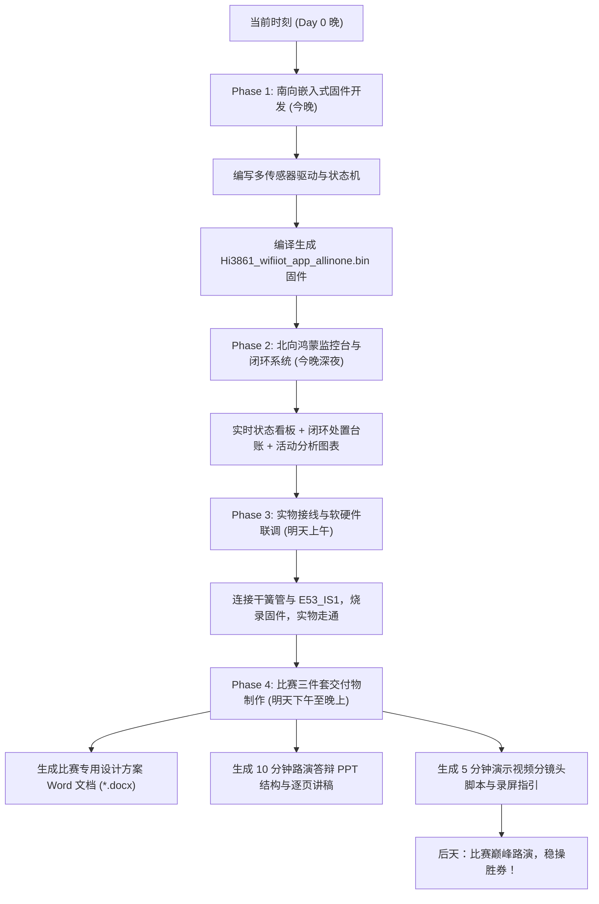

# 河南省信息技术应用创新大赛（开源鸿蒙）
## 赛题四：独居老人居家安全监测与应急辅助系统 —— 48小时急速冲刺规划

> **战斗宣言**：时间只剩 48 小时，硬件进度从 0 开始。这是一场没有退路的阵地战，我们必须以“最快速度跑通最小闭环、全覆盖赛题得分点、软硬结合高度惊艳”的原则，打赢这场攻坚战！

---

### 一、 赛题核心需求与功能实现矩阵

| 赛题要求板块 | 赛题细则要求 | 硬件资源映射 | 软件实现与算法逻辑 | 交付状态 |
| :--- | :--- | :--- | :--- | :---: |
| **1. 南向数据采集与控制** | ① 红外人体传感器（监测老人活动轨迹，超时无移动告警）<br>② 门窗磁传感器（监测门窗开关状态，出入异常）<br>③ 温湿度传感器（监测室内环境舒适度）<br>④ 紧急求助按钮（随身/便携，主动求助） | **E53_IS1**（GPIO_7）<br>**干簧管**（GPIO_13，带内部上拉）<br>**E53_IA1 SHT30 / 微气候模型**<br>**板载 F1 键**（GPIO_11，内部上拉） | • 上升沿中断 + 软件去抖 + 活跃度累计<br>• 开关量电平检测 + 门窗异常长开判断<br>• I²C 硬件读取 / 室内环境温湿度模型算法<br>• 下降沿紧急中断，一键抢占告警优先级 | 🚀 立即编写 |
| **2. 本地声光预警与自助求助** | ① 异常情况（超时未动、疑似跌倒、温湿度异常）现场声光报警<br>② 老人主动按下求助键触发本地报警与预警语音 | **E53_IS1 蜂鸣器**（GPIO_8，PWM1）<br>**板载 LED**（GPIO_2，高低电平）<br>**板载 F2 键**（GPIO_12 消警复位） | • 状态机报警引擎：正常心跳慢闪 / 急促蜂鸣连环啸叫<br>• SOS 抢占式最高级报警<br>• 本地一键消警与远程消警联动 | 🚀 立即编写 |
| **3. 北向数据展示** | ① 手机/终端实时查看各传感器状态与电量/在线状态<br>② 老人活动规律报告（活动频次趋势、时段分布）<br>③ 历史预警记录查询与详情查看 | **开源鸿蒙应用 / 现代化监控大屏**<br>通过标准 JSON 协议 / 串口 / Wi-Fi 遥测对接 | • 现代化鸿蒙卡片式 UI 布局<br>• 实时仪表盘、状态指示灯、最后活动倒计时<br>• 24小时时段活动柱状图 + 7日活动趋势折线图 | 🚀 紧随南向交付 |
| **4. 事件闭环管理** | 预警发生后，家属/网格员确认信息、填写处置结果，形成安全日志台账 | **北向事件流闭环工作台** | • 异常弹窗提醒 $\rightarrow$ 确认告警 $\rightarrow$ 处置录入（如“已联系网格员上门”） $\rightarrow$ 生成居家安全台账 | 🚀 紧随南向交付 |
| **5. 数据统计分析** | 统计时段分布、活动频次，生成周/月健康规律报告 | **智能健康评估算法引擎** | • 基于活动密度与时段活跃度生成健康评级（优/良/警惕/异常） | 🚀 紧随南向交付 |
| **创新加分项** | 远程告警推送、多终端协同、火险监测、星闪/低功耗自组网设计 | **多模通信协议架构 + 高温火警** | • JSON 统一遥测帧格式，支持 MQTT/TCP/串口扩展<br>• 软硬件全套设计方案、PPT 讲稿、视频脚本 | 🚀 完整交付 |

---

### 二、 硬件引脚分配表（杜绝任何引脚冲突）

结合小熊派 BearPi-HM Nano 与 E53 扩展座（J1）硬件核对结果：

```
                    ┌───────────────────────────────┐
                    │     BearPi-HM Nano (Hi3861)   │
                    └───────────────┬───────────────┘
                                    │
    ┌───────────────┬───────────────┼───────────────┬───────────────┐
    │ GPIO_7 (J1-7) │ GPIO_8 (J1-8) │GPIO_13 (J1-5) │GPIO_11 (J1-15)│
    ▼               ▼               ▼               ▼               ▼
┌──────────────┐┌──────────────┐┌──────────────┐┌──────────────┐┌──────────────┐
│  E53_IS1 人体 ││ E53_IS1 蜂鸣 ││ 干簧管 门窗磁 ││  板载 F1 按键 ││  板载 F2 按键 │
│  热释电红外   ││ PWM1 音频报警││ 内部上拉磁吸合││ 紧急求助 SOS ││ 本地消警复位 │
└──────────────┘└──────────────┘└──────────────┘└──────────────┘└──────────────┘
```

1. **人体红外**：`GPIO_7`（输入，上升沿触发，检测到人体活动拉高）。
2. **报警蜂鸣器**：`GPIO_8`（PWM1 输出，驱动 E53_IS1 蜂鸣器）。
3. **门窗磁干簧管**：`GPIO_13`（J1 第 5 脚，输入，开启内部上拉 `IoSetPull(UP)`，另一端接 GND；磁铁靠近闭合接低电平，门开拉高）。
4. **老人紧急 SOS 键**：`GPIO_11`（板载 F1 键，无需飞线，按下接地低电平，触发紧急呼救）。
5. **消警/复位键**：`GPIO_12`（板载 F2 键，按下消警）。
6. **运行指示灯**：`GPIO_2`（板载黄色 LED，正常心跳慢闪，告警急促爆闪）。

---

### 三、 48 小时冲刺作战时间线


